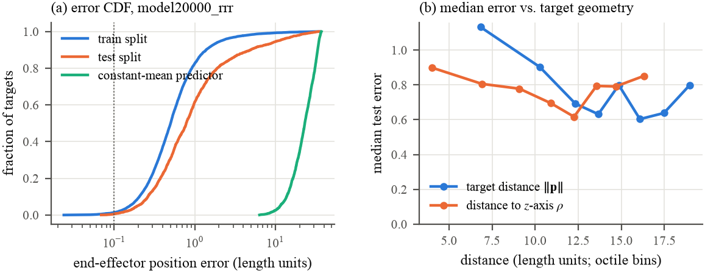
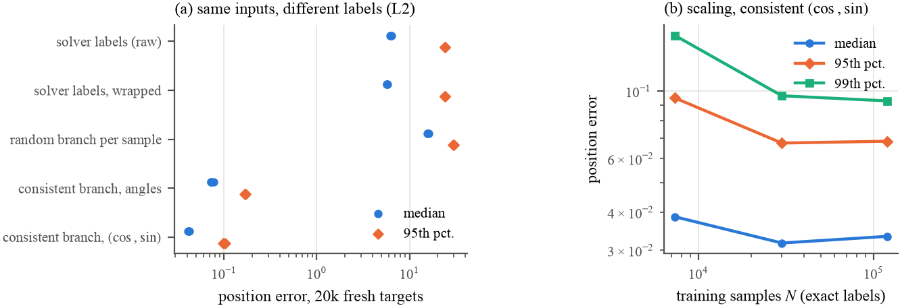

# NN-Ikine: Neural-Network Inverse Kinematics for 3-DOF Arms

Can a neural network learn a robot arm's inverse kinematics (IK) by copying a numerical solver? This repo has the original project (MATLAB Robotics Toolbox + Keras) for two textbook 3-DOF arms, plus a follow-up technical report that checks how well it actually works and what fixes it.

> **Short answer:** the baseline network looks good on paper (74% Keras "accuracy") but its hand lands a median of ~4% of the arm's reach from the target, and misses by more than half the reach on the worst 5% of targets. Most of that error comes from the **training labels**, not the network. With consistent, exact labels and a sine/cosine output, the same network is **43× more accurate at the median** and **~200× more accurate on the hardest targets**. Used as a warm start, it cuts the numerical solver's iterations by **3.5×** and always returns the intended solution.

📄 **Paper:** [`paper/main.pdf`](paper/main.pdf) (IEEE two-column) · [`paper/main_long.pdf`](paper/main_long.pdf) (10-page extended version)
🎞️ **Original project:** [slides](Project_Presentaion.pdf) · [video demo](VIDEO%20DEMONSTRATION.mp4) · [course write-up](Inverse%20Kinematics%20with%20Neural%20Networks%20—%20Technical%20Report.md)

---

## The robots

| Arm | Joints | Notes |
| --- | --- | --- |
| **RRR** (anthropomorphic) | base yaw θ₁, shoulder θ₂, elbow θ₃ | a₂ = a₃ = 10 LU, reach 20 LU, up to 4 IK solutions per target |
| **RPP** (cylindrical) | base yaw θ₁, vertical lift d₂, radial reach d₃ | one solution per target, ~200 LU workspace |

Both arms have closed-form IK, which makes them a clean testbed: every network answer can be checked against the exact solution.

## Pipeline

```
 offline:  random targets ──► ikine (LM, ≤1000 iters) ──► (x,y,z) → (q1,q2,q3) dataset ──► Keras MLP ──► model/*.h5
 online:   target [x y z] ──┬─► ikine ────────────► animate()
                            └─► MLP (via Python) ──► animate()   → compare poses
```

## Results

### Baseline (original 2021 models)

| Model | Arm | Keras acc. | Median error | p95 error | Within 1 LU |
| --- | --- | ---: | ---: | ---: | ---: |
| `model20000_rrr` (test) | RRR | 74.1% | 0.78 LU | 10.92 LU | 61.6% |
| `model20000_rrr` (train) | RRR | 97.3% | 0.50 LU | 2.14 LU | 82.5% |
| `model8000_rpp_rad` (test) | RPP | 99.9% | 2.11 LU | 7.70 LU | — |

Keras's default `'accuracy'` only checks which of the three outputs is largest, so it says almost nothing about IK error. One RPP model scores 91.4% while missing by a median of 148 LU.

<p align="center"></p>

### Why it fails, and what fixes it

- **Inconsistent labels.** `ikine` starts from all-zero joints and picks whichever of the four RRR solutions it converges to, so neighbouring targets get different solution types. The network ends up averaging them.
- **Unwrapped angles.** The solver reports θ and θ + 2π as different answers.
- **Sampling bug.** The RPP generator drew `x` from `[0, 2π]` (an angle range), so the training data covers only ~14% of the base rotation.

Controlled study on the RRR arm (same network and inputs, only the labels and output format change):

<p align="center"></p>

| | Median | p95 | Notes |
| --- | ---: | ---: | --- |
| Solver labels (baseline) | 1.94 LU | 21.9 LU | p95 exceeds the arm's reach |
| Consistent exact labels, (cos, sin) output | **0.045 LU** | **0.11 LU** | 43× / 199× better |
| Same, 30k samples | **0.032 LU** | **0.068 LU** | 99.1% within 0.1 LU, 42% fewer params |

### Learned warm start for the solver

| Starting guess for LM `ikine` | Mean iterations | Intended solution |
| --- | ---: | ---: |
| All zeros (default) | 15.8 | 39.5% |
| Baseline network | 6.2 | 39.7% |
| Improved network | **4.5** | **100%** |

## Repository layout

```
.
├── run_project/            # Ready-to-run demo: MATLAB scripts + trained models
│   ├── rrr_3_link_toolbox.m    RRR IK with Robotics Toolbox ikine + animation
│   ├── rrr_3_link_NN.m         RRR IK with the neural network (calls py_rrr.py)
│   ├── rpp_toolbox.m           RPP IK with ikine + animation
│   ├── rpp_NN.m                RPP IK with the neural network (calls py_rpp.py)
│   ├── py_rrr.py, py_rpp.py    Keras inference bridges
│   ├── model/                  Trained Keras .h5 models
│   └── dataset/                MATLAB ↔ Python exchange files
├── devlopment_project/     # Data generation, training, all trained checkpoints
│   ├── gen.m, gen_rpp.m        Build datasets by running ikine on random targets
│   ├── train.py                Train the Keras MLP
│   ├── inferance.py            Ad-hoc predictions
│   ├── train*.csv              Generated datasets
│   └── model/                  All 7 trained models
├── paper/                  # Technical report: analysis + improvements
│   ├── main.tex, refs.bib      LaTeX source (IEEEtran)
│   ├── code/                   Audit, controlled study, figures, tables (PyTorch/NumPy)
│   ├── results/                Raw results (JSON / NPZ) and the improved model
│   ├── figures/, tables/       Generated from results/
│   └── README.md               Reproduction details
├── Project_Presentaion.pdf # Original course presentation
└── VIDEO DEMONSTRATION.mp4 # Demo of both arms animating
```

## Quick start

### 1. Run the original MATLAB demo

Requirements: MATLAB with [Peter Corke's Robotics Toolbox](https://petercorke.com/toolboxes/robotics-toolbox/), and Python 3 with `numpy pandas scikit-learn tensorflow keras` on your `PATH`.

```matlab
cd run_project
rrr_3_link_toolbox   % enter [x y z], e.g. [1 4 9]; the arm animates to the ikine solution
rrr_3_link_NN        % same target, solved by the neural network
rpp_toolbox
rpp_NN
```

### 2. Reproduce the paper

No MATLAB or TensorFlow needed: `ikcore.py` includes a Python replica of `ikine` and reads the Keras weights straight from the `.h5` files.

```bash
cd paper
python3 -m venv venv && venv/bin/pip install h5py numpy pandas scipy scikit-learn matplotlib torch
cd code
../venv/bin/python audit.py        # Part I: dataset audit + re-evaluation of all shipped models (~30 s)
../venv/bin/python improved.py     # Part II: controlled study, scaling, warm start, latency (~45 min on M1 Pro CPU)
../venv/bin/python figures.py && ../venv/bin/python make_tables.py
cd .. && tectonic --keep-intermediates main.tex
```

See [`paper/README.md`](paper/README.md) for details.

## Authors

Original project: **Durgesh Reddiyar**, **Priyank Patel**, **Rumitkumar Patel**. MAE 547 Modeling and Control of Robots, Arizona State University, Fall 2021.
Technical report and follow-up analysis: **Durgesh S. Reddiyar** (dreddiya@asu.edu).

## Citation

```bibtex
@techreport{reddiyar2026nnik,
  author      = {Durgesh S. Reddiyar},
  title       = {Learning Inverse Kinematics by Imitating a Numerical Solver:
                 Analysis and Improvements on Two 3-DOF Manipulators},
  institution = {Arizona State University},
  year        = {2026}
}
```

## License

[MIT](LICENSE)

## References

- P. Corke, *Robotics, Vision and Control*, Springer. Robotics Toolbox for MATLAB.
- B. Siciliano, L. Sciavicco, L. Villani, G. Oriolo, *Robotics: Modelling, Planning and Control*, Springer, 2009.
- M. I. Jordan and D. E. Rumelhart, "Forward models: Supervised learning with a distal teacher," *Cognitive Science*, 1992.
